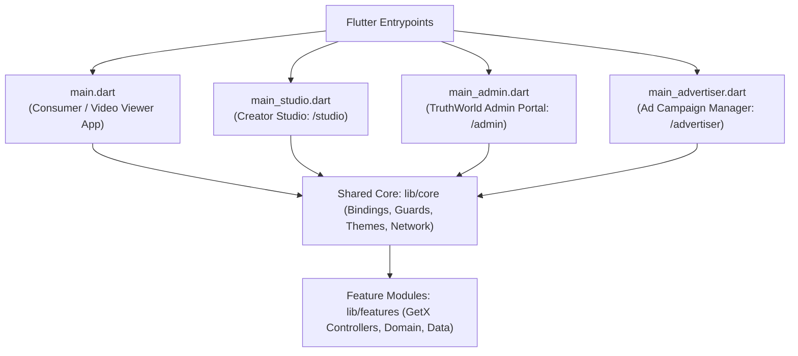
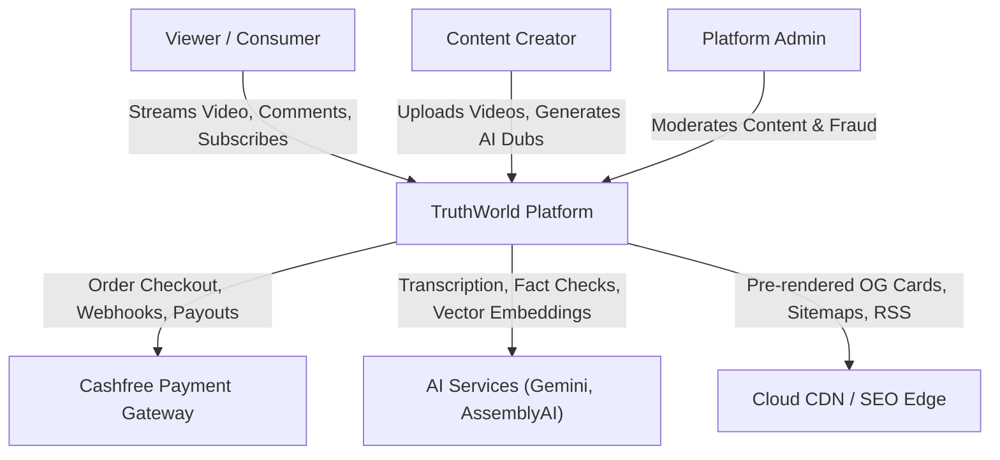

# TruthWorld — System Architecture & Technical Blueprint

TruthWorld is a decentralized, credibility-focused video streaming platform built with **Flutter** (Web, Android, iOS), **Firebase**, and **Google Cloud Functions (2nd Gen)** running in `asia-south1`.

---

## 1. High-Level Tech Stack Overview

| Layer | Technology | Key Modules & Responsibilities |
| :--- | :--- | :--- |
| **Frontend Clients** | Flutter 3.x (Web, Android, iOS) | Multi-flavor entrypoints (`main.dart`, `main_studio.dart`, `main_admin.dart`, `main_advertiser.dart`), GetX state & routing, HLS/DASH video playback |
| **Identity & Security** | Firebase Authentication + Custom Claims | Email/Password, OAuth, RBAC claims (`isAdmin`, `isStudio`, `isAdvertiser`, `tier`), App Check attestation |
| **Application Serverless** | Firebase Cloud Functions (2nd Gen / Node 24 TS) | Video processing pipeline, Cashfree payment gateway, AI search, SEO SSR engine, live viewer tracking |
| **Primary Databases** | Cloud Firestore & Firebase RTDB | Firestore for structured documents; Realtime Database (RTDB) for live viewer counts, active sessions, and live chat |
| **Blob & Video Storage** | Google Cloud Storage (GCS) | Video uploads, HLS streams, dubbed audio tracks, speaker profiles, thumbnails, watermarks |
| **Message Queue / PubSub** | Google Cloud Pub/Sub & Cloud Tasks | Video pipeline fan-out (transcription $\rightarrow$ credibility $\rightarrow$ dubbing), SWR cache invalidation queues |
| **AI & Inference Engines** | Gemini Flash API, AssemblyAI, In-House Vector Search | Automated transcription, credibility scoring, claim normalization, multi-language dubbing (Telugu, Hindi, English), vector embeddings |
| **Payments & Economy** | Cashfree Payment Gateway | UPI/Card checkouts, subscriptions, creator payouts, and fraud detection |

---

## 2. Multi-Flavor Application Architecture

The Flutter client compiles into multiple specialized web & mobile portals from a single shared codebase:



* **Consumer App (`main.dart`)**: Home feed, video player, shorts, topics, channel views, community, comments, watch history, subscriptions.
* **Creator Studio (`main_studio.dart`)**: Video uploads, analytics dashboard, AI features trigger, chapters, drafts, trash, channel wizard.
* **Admin Portal (`main_admin.dart`)**: Bulk video moderation, user trust management, unit economics, platform telemetry.
* **Advertiser Portal (`main_advertiser.dart`)**: Ad campaigns, budget management, impression audits, targeting.

---

## 3. C4 Architecture Model

### Level 1: System Context Diagram


### Level 2: Container Diagram (Cloud Infrastructure)
```mermaid
graph TD
    subgraph Client Applications
        FlutterWeb["Flutter Web App (CDN Hosted)"]
        FlutterMobile["Android / iOS Native App"]
    end

    subgraph Firebase & Google Cloud (asia-south1)
        Auth["Firebase Auth"]
        GCS["Cloud Storage<br/>(Raw Uploads & Transcoded Videos)"]
        PubSub["Cloud Pub/Sub Message Bus"]
        
        subgraph Cloud Functions 2nd Gen
            CF_Pipeline["Video Pipeline Triggers<br/>(Ingest, Transcription, Dubbing)"]
            CF_Publish["Publish Gate & Shard Sync<br/>(Fan-out to Feeds)"]
            CF_Economy["Cashfree & Creator Economy<br/>(Orders, Webhooks, Payouts)"]
            CF_SEO["SEO SSR Server<br/>(Metadata, JSON-LD, Sitemaps)"]
            CF_Search["AI Vector Search<br/>(Hybrid Search Backend)"]
        end

        Firestore[("Cloud Firestore<br/>(Videos, Users, Channels, Orders)")]
        RTDB[("Realtime Database<br/>(Live Viewers, Chat)")]
    end

    FlutterWeb -->|Authenticate| Auth
    FlutterMobile -->|Authenticate| Auth

    FlutterWeb -->|Direct Upload with Resumable URL| GCS
    GCS -->|onObjectFinalized| CF_Pipeline
    CF_Pipeline -->|Publish Steps| PubSub
    PubSub -->|Workers| CF_Pipeline
    CF_Pipeline -->|Save Metadata & Status| Firestore

    Firestore -->|onDocumentUpdated (Published)| CF_Publish
    CF_Publish -->|Update Counter Shards| Firestore

    FlutterWeb -->|Callable RPC| CF_Economy
    CF_Economy -->|Process Orders| Firestore

    FlutterWeb -->|Direct Realtime Sync| RTDB
    FlutterWeb -->|Server-Side Social Crawlers| CF_SEO
```

---

## 4. Architectural Decision Records (ADRs)

* **ADR-001 (Scale-to-Zero Cloud Functions):** All Cloud Functions 2nd Gen are configured with `minInstances: 0` and region `asia-south1` to optimize serverless operating costs while handling traffic spikes.
* **ADR-002 (Gated Publishing Pipeline):** Videos are never made public immediately upon upload. They must pass resolution transcoding, automated moderation, copyright scanning, and fact-checking aggregation before reaching `published` status.
* **ADR-003 (Counter Sharding for High Concurrency):** High-frequency counters (video views, impressions, likes, subscribers) use distributed counter shards to prevent Firestore 1 write/second document contention limits. Shards are periodically aggregated by `rollupVideoCounterShards`.
* **ADR-004 (Hybrid Realtime Database + Firestore):** Ephemeral high-throughput state (active video viewers, typing status, live chat) is stored in RTDB, while persistent relational documents (user profiles, video metadata, financial records) live in Firestore.
* **ADR-005 (Decoupled Clean Architecture & Modular Routing):** Zero framework coupling in Domain and Data layers (`GetX`, `Flutter Widgets` are prohibited in `lib/domain` and `lib/data`). Repositories receive dependencies via constructor injection. Routing is modularized by feature (`lib/routes/modules/*`), centralized in `AppRoutes`, and abstracted behind `AppNavigator` facade for testability and loose coupling.
