# 🏛️ TruthWorld Factcheck Pipeline Architecture & Bug Localization Flow

TruthWorld features an enterprise-grade, high-throughput Fact-Checking and Credibility Pipeline designed for absolute epistemic transparency, zero false certainty, and complete explainability.

This document serves as the **master architecture reference** for any developer or AI Agent working on TruthWorld's Factcheck Pipeline.

---

## 1. Core Architectural Principles
1. **Zero Raw Developer Error Exposure**: End users never see stack traces or cryptic exception codes. Errors are transformed into polite, standard English with actionable guidance.
2. **"No Claim Left Unchecked"**: 100% of verifiable empirical claims are evaluated. Videos never receive incomplete or arbitrary partial verdicts.
3. **Verifiable Claim Ledger**: Ambiguous scalar scores (e.g. "87/100") are replaced with a transparent, verifiable ledger:
   `[Confirmed] • [Disputed] • [False] • [Unproven] • [Contextual]`
4. **Closed-World Citation Firewall**: Eliminates hallucinations and phantom links. Only verified, crawlable URLs with authoritative domain whitelisting are admitted.
5. **Scale-to-Zero & 4-Tier Cascade**: High-speed, zero-cost deterministic caches (Tier 1 & Tier 2) serve stable truths in `< 50ms`, while complex claims escalate to Fast-Track LLM (Tier 3) or Deep Grounded Fused Verification (Tier 4).
6. **Instant Bug Localization**: Every execution is instrumented with `FactcheckDiagnosticTracker`. If a failure occurs, logs and Firestore records declare the exact **Stage**, **Component**, **Context**, and **Troubleshooting Remedy**.

---

## 2. End-to-End Pipeline Flow Diagram

```mermaid
flowchart TD
    A["Trigger: Video Upload / On-Demand AI"] --> S1["Stage 01: Pre-flight & Idempotency<br/>(DistributionLayer & CircuitBreaker)"]
    S1 --> S2["Stage 02: Resilient Input Resolution<br/>(Transcript or Direct GCS Multimodal)"]
    S2 --> S3["Stage 03: Rate Limiting & Safety Quota Gates<br/>(Max 3/day unverified, 30/200 claims)"]
    S3 --> S4["Stage 04: Claim Extraction & Intent Detection<br/>(Gemini 3.5 Flash Lite + ContentIntent)"]
    S4 --> S5["Stage 05: Claim Ranking & Stream Registration<br/>(StreamingClaimProcessor -> /videos/{id}/claims)"]
    S5 --> S6["Stage 06: Contextual Source Harvesting<br/>(Creator Provided + Dispute + Community Sources)"]
    S6 --> S7["Stage 07: Four-Tier Cascade Verification<br/>(T1 Cache -> T2 Registry -> T3 LLM -> T4 Grounded)"]
    S7 --> S8["Stage 08: Ledger & Clinical Explainability<br/>(Verifiable Claim Ledger & Citation Firewall)"]
    S8 --> S9["Stage 09: Persist Draft & Trigger Synthesis<br/>(GCS draft offload + Async PubSub trigger)"]
    S9 --> S10["Stage 10: Multi-Path Storage & Event Dispatch<br/>(Storage full.json/latest.json + fact-complete)"]
    S10 --> S11["Stage 11: Vertex AI Token Cost Attribution<br/>(JobTokenTracker & Grounding attribution)"]

    style S1 fill:#1e293b,stroke:#3b82f6,stroke-width:2px,color:#fff
    style S2 fill:#1e293b,stroke:#3b82f6,stroke-width:2px,color:#fff
    style S3 fill:#1e293b,stroke:#3b82f6,stroke-width:2px,color:#fff
    style S4 fill:#1e293b,stroke:#3b82f6,stroke-width:2px,color:#fff
    style S5 fill:#1e293b,stroke:#10b981,stroke-width:2px,color:#fff
    style S6 fill:#1e293b,stroke:#3b82f6,stroke-width:2px,color:#fff
    style S7 fill:#1e293b,stroke:#8b5cf6,stroke-width:2px,color:#fff
    style S8 fill:#1e293b,stroke:#f59e0b,stroke-width:2px,color:#fff
    style S9 fill:#1e293b,stroke:#3b82f6,stroke-width:2px,color:#fff
    style S10 fill:#1e293b,stroke:#10b981,stroke-width:2px,color:#fff
    style S11 fill:#1e293b,stroke:#64748b,stroke-width:2px,color:#fff
```



---

## 3. The 11 Modular Pipeline Stages

| Stage Number | Stage Identifier | Primary Service / Component | Input Artifacts | Output Artifacts | Primary Responsibility |
|---|---|---|---|---|---|
| **01** | `01_PREFLIGHT_AND_IDEMPOTENCY` | `DistributionLayer`, Circuit Breaker | `jobId`, `eventId` | Deduplication status | Checks distributed circuit breaker and guards against duplicate execution. |
| **02** | `02_INPUT_AND_MEDIA_RESOLUTION` | `CredibilityEngine.loadTranscript`, Vertex AI | `jobId`, `targetVideoId` | Diarized transcript / utterances | Resolves transcript from Firestore/Storage, or falls back to zero-copy direct media analysis. |
| **03** | `03_QUOTA_AND_SAFETY_GATES` | `RateLimiter`, Firestore | `userId`, `channelTier` | `effectiveMaxClaims` | Enforces rate limits (3 runs/day free) and bounds claim counts (30 vs 200). |
| **04** | `04_CLAIM_EXTRACTION_AND_INTENT` | `FactExtractionService`, `contentIntentDetector` | Utterances, Video context | `ExtractedClaim[]`, `domainInfo` | Extracts atomic empirical claims, classifies domain stance, and detects promotional vs factual intent. |
| **05** | `05_RANKING_AND_STREAMING` | `classifyAndRank`, `StreamingClaimProcessor` | `rawClaims` | `FilteredClaim[]` | Ranks claims by importance/framing and registers initial claims in Firestore subcollection for real-time frontend display (< 100ms TTFC). |
| **06** | `06_SOURCE_HARVESTING` | `sourceTrustService`, Community Sources | `jobData`, `videos/{id}/claim_sources` | `creatorProvidedSources` | Ingests, dedupes, and validates creator-provided, dispute, and community citations with strict protocol checks. |
| **07** | `07_CASCADE_VERIFICATION` | `VerificationCascadeService` | `topClaims`, Context | `VerifiedClaim[]`, `hitRate` | Executes 4-tier verification cascade with fast-knowledge fallback and recovery sweeps for timeouts. |
| **08** | `08_LEDGER_AND_EXPLAINABILITY` | `buildExplainability`, `ClaimLedger` | `allVerified` | `ClaimLedgerSummary`, Explainability | Compiles transparent ledger counts (Confirmed, Disputed, False) and formats clinical reasoning with citation firewall. |
| **09** | `09_PERSISTENCE_AND_DISPATCH` | `analysisRepository`, GCS Bucket | `allVerified`, Draft data | `credibility_drafts/{id}` | Offloads verified claims draft to GCS/Firestore and triggers background async synthesis pass. |
| **10** | `09_PERSISTENCE_AND_DISPATCH` | `AnalysisRepository`, PubSub | `CredibilityResult` | `factChecks/{id}/full.json` | Stores final result in Storage, updates Firestore jobs/video docs, and emits `fact-complete` event. |
| **11** | `10_COST_ATTRIBUTION` | `costEngine`, `JobTokenTracker` | Token counts, Query counts | Firestore `costs/{id}` | Records exact Vertex AI input/output token usage, search grounding query fees, and compute duration. |

---

## 4. Observability & Root-Cause Bug Localization

When an error or unexpected state occurs during Fact-Checking, TruthWorld logs an explicit, formatted error box and persists diagnostic metadata into Firestore (`video_jobs` and `credibility_jobs`):

```text
================================================================================
🚨 TRUTHWORLD FACTCHECK PIPELINE ERROR DETECTED
================================================================================
• Job ID:           video_job_991823
• Target Video ID:  vid_882194
• Failed Stage:     07_CASCADE_VERIFICATION
• Failed Component: VerificationCascadeService
• Root Cause:       Vertex AI Google Grounding quota exceeded (RESOURCE_EXHAUSTED 429)
• Troubleshooting:  Verify Vertex AI Grounding project quota and billing credentials in GCP console
================================================================================
```

### Bug Troubleshooting Matrix for Developers & AI Agents

| If Error Occurs In... | Component Responsible | Likely Cause | Exact Remedy |
|---|---|---|---|
| `01_PREFLIGHT_AND_IDEMPOTENCY` | `DistributionLayer` / Circuit Breaker | Distributed circuit breaker tripped due to consecutive upstream AI outages. | Inspect `system_health/credibility_circuit_breaker` in Firestore; verify Gemini / Vertex AI provider status. |
| `02_INPUT_AND_MEDIA_RESOLUTION` | `loadTranscript` / `normalizeToGcsUri` | No transcript found in Firestore/Storage and raw video URL missing or unreadable. | Check GCS bucket permissions for `uploads/raw_videos/{id}.mp4` or inspect upstream transcription stage. |
| `03_QUOTA_AND_SAFETY_GATES` | Firestore `rate_limits` | Channel has exceeded the 3 daily fact-checking runs. | User hit free tier quota; tier automatically throttles to standard or requires creator verification. |
| `04_CLAIM_EXTRACTION_AND_INTENT` | `FactExtractionService` | Audio is silent, music-only, or Gemini Flash Lite token budget timed out. | Check audio codec/quality in ffprobe; verify `GEMINI_API_KEY` secret in Google Cloud Functions. |
| `05_RANKING_AND_STREAMING` | `StreamingClaimProcessor` | Firestore permission error on subcollection `videos/{id}/claims`. | Verify Firestore Security Rules for `videos/{id}/claims/{claimId}` (must allow Cloud Function write). |
| `06_SOURCE_HARVESTING` | `sourceTrustService` / URL Sanitizer | Malformed URL, SSRF IP target, or invalid URI protocol in provided sources. | Ensure sources use standard HTTPS/HTTP protocols; invalid URLs are filtered automatically. |
| `07_CASCADE_VERIFICATION` | `VerificationCascadeService` / Grounding | Grounding API quota exhausted (429) or external adapter (PubMed/Wikipedia) timed out. | Check Vertex AI Grounding quota; fast knowledge fallback activates automatically to recover claims. |
| `08_LEDGER_AND_EXPLAINABILITY` | `buildExplainability` / Citation Firewall | Domain in source does not meet closed-world citation firewall standards. | Check `urlVerificationService` whitelist and domain resolution; quarantined sources are isolated. |
| `09_PERSISTENCE_AND_DISPATCH` | `analysisRepository` / Storage Bucket | Cloud Storage write permissions or document size > 1MB. | Large drafts (> 500KB) are offloaded to GCS `factChecks/{id}/draft_claims.json`. |
| `10_COST_ATTRIBUTION` | `costEngine` | Non-fatal token ledger parsing warning. | Non-fatal; fallback chunk estimation ensures accounting continuity. |

---

## 5. Verification & Testing Instructions

To run the pipeline verification tests:

```bash
# Run 10-Claim End-to-End Unit Verification
npm test tests/unit/tenClaimsFactChecking.test.ts

# Run 10 Critical Claims Grounded Sample Test
npm test tests/unit/tenCriticalClaimsVideoSample.test.ts

# Run Pipeline Diagnostics & Bug Traceability Test
npm test tests/unit/factcheckPipelineDiagnostics.test.ts

# Run Full TypeScript Build & Endpoint Manifest Verification
npm run build
```
