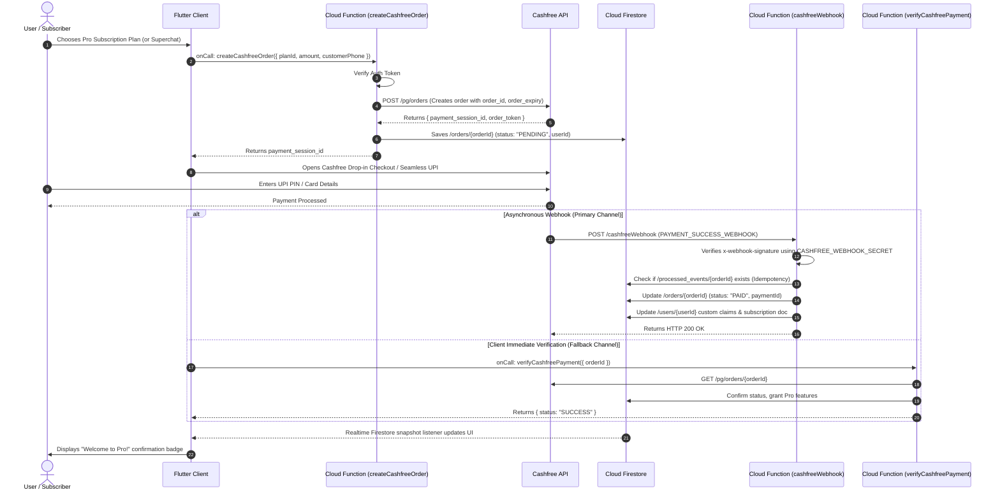
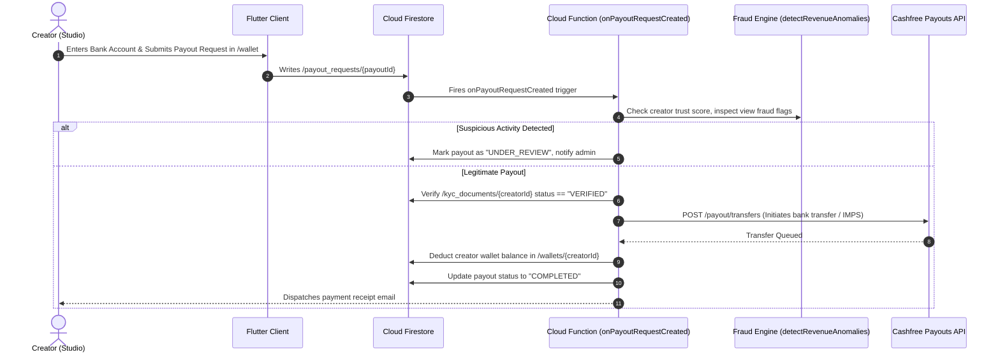

# Architecture Flow: Payments & Creator Economy (Cashfree)

TruthWorld integrates with **Cashfree Payment Gateway** for subscription billing (Pro tier), creator tipping/superchats, and automated creator earnings payouts.

---

## 1. Cashfree Checkout & Webhook Lifecycle

---

## 2. Creator Payouts & Monetization Flow

Creators earn money through two streams:
1. **Ad Revenue Share**: Distributed according to verified video impressions and view duration.
2. **Pro Subscription Pool**: Distributed monthly via `distributePremiumRevenue` based on minutes watched by Pro subscribers.

