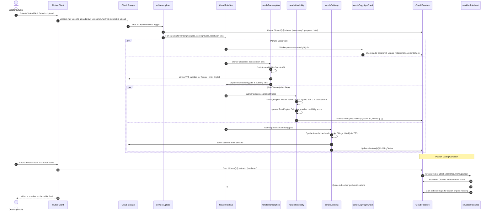
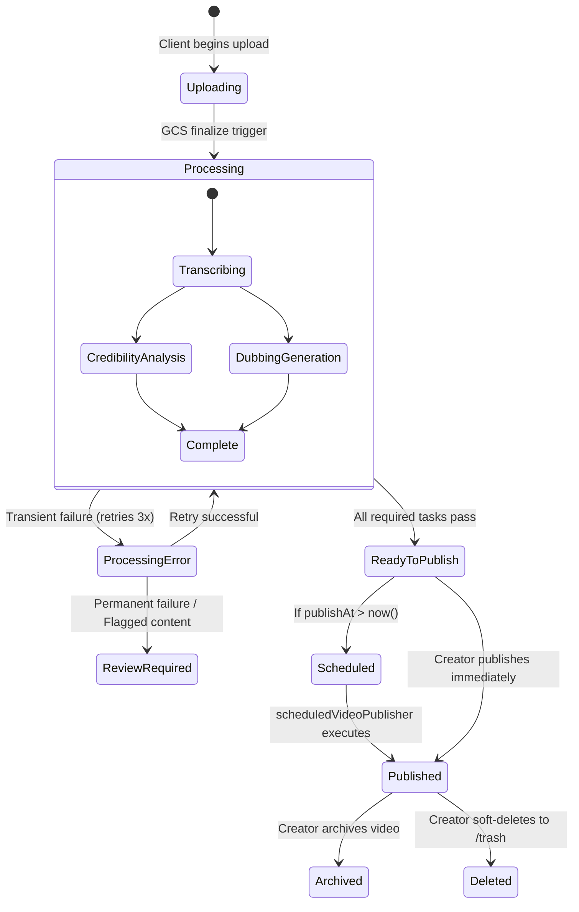

# Architecture Flow: Video Processing & Credibility Pipeline

TruthWorld features an automated multi-stage pipeline for video ingestion, AI transcription, claim fact-checking, speaker trust analysis, multi-language dubbing, and gated publishing.

---

## 1. End-to-End Pipeline Sequence Diagram

---

## 2. Pipeline State Transitions & Fail-Safe Mechanics

Every video document in Firestore moves through defined state machines:

---

## 3. Idempotency & Error Recovery

1. **At-Least-Once Delivery**: Because Cloud Pub/Sub guarantees at-least-once delivery, every pipeline worker checks `idempotency-engine.ts` before starting expensive AI inference.
2. **Reconciliation Cron**: If an encoding or transcription job halts mid-flight (e.g. timeout), the scheduled cron `reconcileStuckResolutionJobsScheduled` detects any video stuck in `"processing"` for more than 45 minutes and safely requeues the task.
