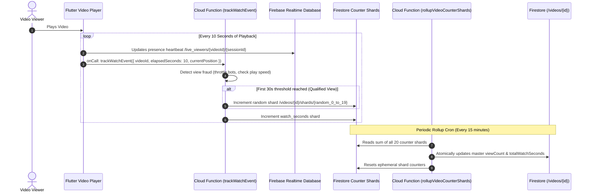

# Architecture Flow: Watchtime, Live Viewers & High-Concurrency Analytics

TruthWorld handles high-frequency events (watchtime ticks, view counting, live viewer presence, and impressions) without running into Firestore document contention bottlenecks.

---

## 1. Real-Time Watchtime & Video View Counting Flow



---

## 2. Live Stream Viewers & Chat Architecture

* **High-Throughput Presence**: Realtime Database (RTDB) handles concurrent live viewer counts. When a client connects, Firebase RTDB `.info/connected` attaches an `onDisconnect()` handler:
  ```json
  /live_sessions/{videoId}/{userId}: {
    "active": true,
    "joinedAt": 1718000000000
  }
  ```
* **Disconnect Automation**: When a viewer closes their browser or app, Firebase RTDB automatically removes the session key server-side.
* **Aggregated Count**: The `onActiveViewerWrite` trigger calculates the active count and updates `/live_streams/{videoId}/viewerCount` for display on the player UI.
