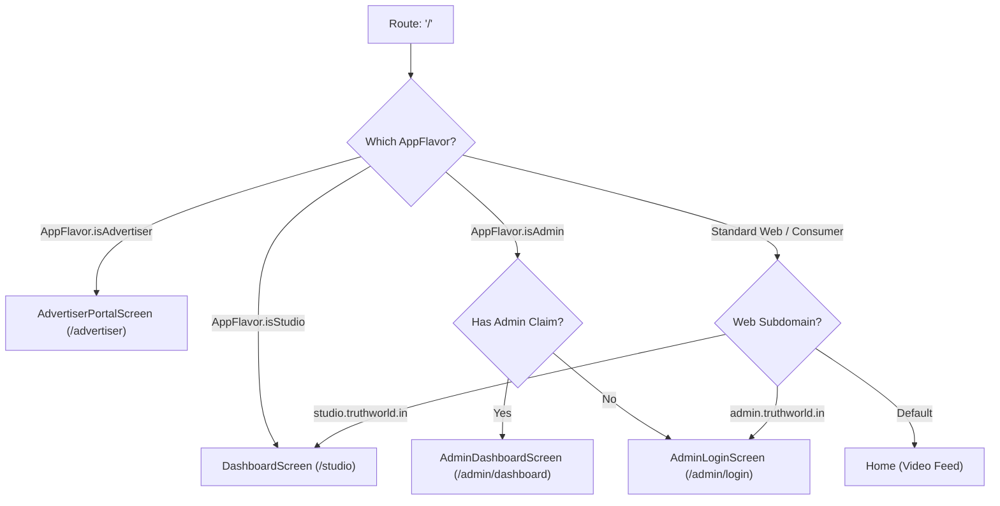

# TruthWorld — Frontend Pages & Screen Catalog

All navigation in the TruthWorld Flutter application is managed through **GetX Routing** (`lib/routes/app_pages.dart`). This document catalogs all routes, multi-flavor entry conditions, route guards, controllers, bindings, and screen purposes.

---

## 1. App Flavors & Initial Route Mapping (`/`)

The root route `/` dynamically evaluates the build flavor, user claims, and hostname to render the appropriate landing screen:

---

## 2. Master Route Catalog & Access Matrix

### A. Core Consumer & Video Streaming Routes
| Route | Component / View | Guard / Middleware | Binding / Controller | Key Responsibilities |
| :--- | :--- | :--- | :--- | :--- |
| `/` | `Home` | `HomeBinding` | `HomeController` | Main personalized video feed, trending topics, sidebar navigation |
| `/home` | `Home` | `HomeRedirectMiddleware` | `HomeBinding` | Alias for home feed; redirects studio flavors to studio dashboard |
| `/watch` | `VideoScreen` | `ConsumerRouteGuard` | `VideoBinding` | Full video player (HLS/DASH), fact-check panel, comments, suggestions |
| `/watch/:videoId` | `VideoScreen` | `ConsumerRouteGuard` | `VideoBinding` | Direct video permalink player (e.g. `/watch/abc123xyz`) |
| `/v/:videoId` | `VideoScreen` | `ConsumerRouteGuard` | `VideoBinding` | Shortened video permalink |
| `/shorts/:videoId` | `VideoScreen` | `ConsumerRouteGuard` | `VideoBinding` | Vertical short-form video player with gesture swiping |
| `/clips` | `ClipsPage` | None | `VideoFeatureBinding` | Shorts & video clips discovery feed |
| `/category` | `CategoryPage` | None | `CategoryBinding` | Browse videos by genre/category (News, Science, Tech, Politics) |
| `/trending` | `TrendingPage` | None | `TrendingBinding` | Real-time trending videos ranked by viral velocity & credibility |
| `/search` | `SearchPage` | None | `SearchController` | Hybrid keyword & AI Vector semantic search |
| `/about` | `About` | None | None | TruthWorld platform mission, credibility scoring explanation |

---

### B. Creator Studio Routes (`/studio/*`)
| Route | Component / View | Guard / Middleware | Binding / Controller | Key Responsibilities |
| :--- | :--- | :--- | :--- | :--- |
| `/studio` | `DashboardScreen` | `StudioRedirectMiddleware`, `StudioAccessGuard` | `DashboardBinding` | Creator hub: channel overview, quick upload, recent video metrics |
| `/dashboard` | `DashboardScreen` | `DashboardRedirectMiddleware`, `StudioAccessGuard` | `DashboardBinding` | Alias for creator dashboard |
| `/studio/chapters` | `DashboardScreen` | `StudioAccessGuard` | `DashboardBinding` | Video chapter editor and auto-AI chapter generator |
| `/studio/drafts` | `DashboardScreen` | `StudioAccessGuard` | `DashboardBinding` | Unfinished video drafts, pending thumbnail generations |
| `/studio/trash` | `DashboardScreen` | `StudioAccessGuard` | `DashboardBinding` | Soft-deleted videos (recoverable for 30 days) |
| `/analytics` | `CreatorAnalyticsDashboard` | `StudioAccessGuard` | `AnalyticsBinding` | Deep creator metrics: watchtime, CTR, retention curves, audience |
| `/watchtime` | `WatchTimePage` | `StudioAccessGuard` | `AnalyticsBinding` | Minute-by-minute watchtime breakdown & monetizable hours |
| `/views` | `ViewsPage` | `StudioAccessGuard` | `AnalyticsBinding` | Real-time and daily view counts |
| `/subscribers` | `SubscribersPage` | `StudioAccessGuard` | `AnalyticsBinding` | Subscriber growth, churn rate, and audience geography |

---

### C. Video & Content Creation Routes (`/upload/*`)
| Route | Component / View | Guard / Middleware | Binding / Controller | Key Responsibilities |
| :--- | :--- | :--- | :--- | :--- |
| `/upload` | `UploadSelectionScreen` | `AuthGuard` | `VideoFeatureBinding` | Content selection hub (Video, Subtitles, Dubbing, Community post, Playlist) |
| `/upload/video` | `CreateContentScreen` | `AuthGuard` | `VideoFeatureBinding` | Multi-step video upload: metadata, thumbnail, HLS processing, language tags |
| `/upload/dubbing` | `UploadAudioTrackDubbingPage` | `AuthGuard` | `VideoFeatureBinding` | Configure multi-lingual audio tracks & voice dubbing |
| `/upload/community`| `CommunityPostUploadScreen`| `AuthGuard` | `CommunityPostUploadBinding` | Create text, poll, or image posts for subscribers |
| `/create-playlist` | `CreatePlaylistScreen` | `AuthGuard` | `PlaylistBinding` | Build custom video playlists |
| `/create-topic` | `CreateTopicScreen` | `AuthGuard` | `TopicsBinding` | Create community discussion topics for debate |

---

### D. Channels & Social Interaction Routes
| Route | Component / View | Guard / Middleware | Binding / Controller | Key Responsibilities |
| :--- | :--- | :--- | :--- | :--- |
| `/channel/:channelId` | `ChannelDetailsPage` | `ConsumerRouteGuard` | `ChannelBinding` | Channel profile: videos, playlists, community tab, credibility badge |
| `/@:handle` | `ChannelDetailsPage` | `ConsumerRouteGuard` | `ChannelBinding` | Custom handle lookup (e.g. `/@truthcreator`) |
| `/channelscreen` | `ChannelScreen` | `ChannelCreationGuard` | `ChannelBinding` | Channel onboarding wizard for new creators |
| `/channel-plan-comparison`| `ChannelPlanComparisonScreen`| None | `ChannelBinding` | Creator tier comparison (Free vs Partner vs Enterprise) |
| `/subscriptions` | `Subscriptions` | `AuthGuard` | `SubscriptionsBinding` | Feed of newly published videos from followed channels |
| `/post/:postId` | `CommunityPostScreen` | `ConsumerRouteGuard` | `CommunityBinding` | Single community post view, comments, and poll results |
| `/topic/:slug` | `TopicPage` | `ConsumerRouteGuard` | `TopicsBinding` | Topic discussion thread with multi-perspective claim breakdown |
| `/following-topics` | `FollowingTopicsPage` | `AuthGuard` | `TopicsBinding` | Personalized feed of followed discussion topics |

---

### E. User Library, History & Monetization
| Route | Component / View | Guard / Middleware | Binding / Controller | Key Responsibilities |
| :--- | :--- | :--- | :--- | :--- |
| `/library` | `LibraryScreen` | None | `LibraryBinding` | Quick access to history, watch later, playlists, and downloads |
| `/history` | `WatchHistory` | `ConsumerRouteGuard` | `WatchHistoryBinding` | Chronological list of watched videos with resume timestamps |
| `/likedvideos` | `LikedVideoScreen` | `ConsumerRouteGuard` | `LikedVideosBinding` | Upvoted and liked videos playlist |
| `/watchlater` | `WatchLaterScreen` | `AuthGuard` | `WatchLaterBinding` | Bookmarked videos queue |
| `/premium` | `PremiumPlansScreen` | None | `PremiumBinding` | Ad-free subscription plans, high-bitrate streaming perks |
| `/wallet` / `/user-wallet`| `WalletScreen` | `AuthGuard` | `WalletBinding` | Creator earnings, ad revenue balance, payout requests |
| `/checkout` | `CheckoutScreen` | `AuthGuard` | `EconomyBinding` | Cashfree payment gateway order initialization |
| `/payment-result` | `PaymentResultScreen` | None | `EconomyBinding` | Post-payment confirmation & redirect handler |

---

### F. Administrative & Advertiser Portals
| Route | Component / View | Guard / Middleware | Binding / Controller | Key Responsibilities |
| :--- | :--- | :--- | :--- | :--- |
| `/admin/login` | `AdminLoginScreen` | None | `AdminBinding` | Secure administrator authentication |
| `/admin/dashboard`| `AdminDashboardScreen`| `RequireAdmin` claim | `AdminController` | Content moderation queue, copyright DMCA review, fraud alerts, unit economics |
| `/advertiser` | `AdvertiserPortalScreen`| `AuthGuard` | `AdvertiserBinding` | Self-serve ad portal: create in-stream video ads, set budgets, view CTR |

---

## 3. Route Guard & Middleware Architecture

In `lib/core/utils/route_guards.dart` and `route_redirect_middleware.dart`:
1. **`AuthGuard`**: Intercepts unauthenticated users and displays the login modal/sheet without disrupting their browsing history.
2. **`StudioAccessGuard`**: Validates whether the user owns a channel or has creator privileges. If not, redirects to `/channelscreen` (channel creation wizard).
3. **`ConsumerRouteGuard`**: Prevents creator studio subdomains (`studio.truthworld.in`) from wandering into consumer feeds.
4. **`ChannelCreationGuard`**: Checks if the user already has a channel; if they do, routes them straight to `/channel-details` instead of re-running the creation wizard.

---

## 4. Modular Route Architecture & Decoupled Navigation

To comply with **Industry Standard Flutter Clean Architecture**, routing is fully decoupled from monolithic page declarations:

### A. Modular Feature Route Registries (`lib/routes/modules/`)
Rather than a single 900+ line God-file, routes are segregated by bounded context:
* `CoreRoutes` (`lib/routes/modules/core_routes.dart`): Shell, dynamic flavor entry points, search, about.
* `VideoRoutes` (`lib/routes/modules/video_routes.dart`): Fullscreen video player, shorts, clips, category, trending.
* `StudioRoutes` (`lib/routes/modules/studio_routes.dart`): Creator studio dashboard, chapters, drafts, trash, analytics.
* `UploadRoutes` (`lib/routes/modules/upload_routes.dart`): Multi-step upload wizard, subtitles, dubbing, community posts.
* `ChannelRoutes` (`lib/routes/modules/channel_routes.dart`): Creator profile, channel handle routing, wizard, subscriptions.
* `CommunityRoutes` (`lib/routes/modules/community_routes.dart`): Community posts, topics, debates, saved items.
* `UserLibraryRoutes` (`lib/routes/modules/user_library_routes.dart`): Watch history, bookmarks, offline downloads, profile settings.
* `AdminRoutes` (`lib/routes/modules/admin_routes.dart`): Admin login, moderation dashboard, RBAC guards.
* `AdvertiserRoutes` (`lib/routes/modules/advertiser_routes.dart`): Advertiser campaign management portal.
* `EconomyRoutes` (`lib/routes/modules/economy_routes.dart`): Premium subscription tiers, creator wallet, Cashfree checkout.
* `LegalRoutes` (`lib/routes/modules/legal_routes.dart`): Terms, privacy policy, guidelines, copyright/DMCA.

### B. Strongly-Typed Route Constants (`AppRoutes`)
`lib/routes/app_routes.dart` defines all canonical route constants (`AppRoutes.watch`, `AppRoutes.studio`, etc.), eliminating brittle magic strings across UI widgets and controllers.

### C. Type-Safe Navigation Facade (`AppNavigator`)
`lib/core/navigation/app_navigator.dart` exposes an abstract `INavigationService` and `AppNavigator` facade (`toWatch()`, `toChannel()`, `toStudio()`, etc.). UI components and presentation controllers navigate via this contract, decoupling business logic from direct GetX routing primitives and enabling effortless unit test mocking.
