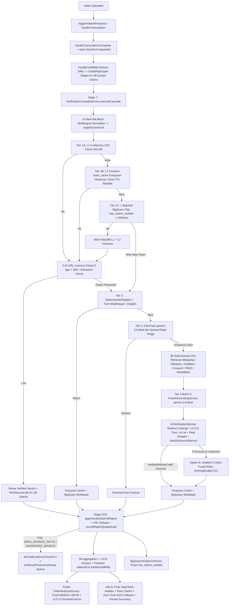

# TruthWorld Credibility System — End-to-End Hardening & Cost-Optimization Design Spec

**Date:** 2026-11-27  
**Status:** Approved (`1A` + `2A` + `Option 1` + `C1–C3` Locked by User & Engineering Calls)  
**Selected Approach:** Approach A — Cost-Optimized Hardened Cascade with Cache + BigQuery Tier 1 Reuse  
**Triggering Evidence:** *"Moon Landing Dark reality"* audit (`30` claims: `26` `NO EVIDENCE YET`, `1` `Verified`, `2` `Caution`, `1` `False`; `5` sources with duplicate `nasa.gov`, Google `G` logo + `"Verified Source"` on `spacecentre.nz`, `1:40:00` timestamp bug, broken Ask AI `"0 verified assertions"` financial stub) + `4` failing tests in `functions/tests/pipeline/credibility_audit_fixes.test.ts`.

---

## 1. Intent, Goals, Non-Goals & Anti-Goals

### Intent & Why
Make TruthWorld's Credibility & Fact-Check System work **end-to-end to industry epistemic standards while staying cost-effective**, across the backend verification pipeline (`functions/src/pipeline`), BigQuery + Firestore Tier 1 ledger (`functions/src/analytics/bigqueryService.ts`), Ask AI chat (`functions/src/pipeline/aiCredibilityChat.ts`), report quality audits, and the Flutter client (`lib/features/video`, `lib/core`).

### Goals
1. **Tier 1 Multi-Layer Knowledge Reuse (`1A + 2A`) — Cache -> BigQuery -> Tiers 2–4 Only for New Claims:**
   - Every incoming claim checks **Tier 1 in strict order**:
     1. **Tier 1A — L1 In-Memory LRU Cache** (`5000` max entries, `0 ms`, `$0`)
     2. **Tier 1B — L2 Firestore `claim_cache`** (`10–50 ms`), persisted **evergreen** (`1A`) for settled/historical/past-dated/science claims
     3. **Tier 1C — BigQuery Permanent Ledger `raw_claims_verified`** (`BigQueryAnalyticsService`): ONE batched parameterized SQL lookup for any remaining misses across historical videos — even years later or after cache cleanup/eviction — and automatically warm-backfills L1 + L2 Firestore on hit.
   - Once verified (e.g., *"Narendra Modi was elected PM in 2014"*), **no subsequent video ever re-runs Tier 2, Tier 3, or Tier 4** (`$0` LLM, `$0` `$0.014` Search Grounding) regardless of how many videos contain that claim.
   - Multilingual equivalents (e.g., Telugu + English phrasing of the same claim) map to shared English canonical hashes in Tier 1.
   - Only **truly new claims** (not in Cache and not in BigQuery), dead/retracted source citations, or explicitly volatile mutable/breaking claims (`today`, `just announced`, live current figures past short `2d–30d` TTL) cascade down into **Tier 2 → Tier 3 → Tier 4**. Once verified, Stage 7/10 writes back to L1 Memory, L2 Firestore `claim_cache`, and BigQuery `raw_claims_verified`, alongside a one-time backfill script (`2A`) for historical Firestore/GCS claims.
2. **High Grounding Recall Without Bloat:**
   - Eliminate batch query dilution where 5-claim batches (`thinkingBudget: 0`) drop source attributions on 26/30 claims.
   - Pre-retrieve `$0`/query open authoritative sources (Wikipedia EN/native, Wikidata, PubMed, Crossref, World Bank, FRED) for *all* general factual domains (not just `HEALTH_MEDICAL`/`Science`) using one low-cost `gemini-3.5-flash-lite` batch translation pass per video.
   - Execute isolated 1-claim retry *only* on claims still sourceless/unproven after Tier 4 batching.
3. **Closed-World Source Integrity (Zero Synthetic HTTP 200s):**
   - Resolve `vertexaisearch.cloud.google.com/grounding-api-redirect/...` redirects in Tier 4 via `UrlVerificationService.verifyBatch` (leveraging `url_verification_cache`), expanding TLD resolution beyond `.gov/.org/.com/.in` to support ccTLDs like `.nz`, `.uk`, `.au`, `.jp`, etc.
   - Preserve authentic extracted source snippets/excerpts rather than overwriting `source.snippet` with the claim's own AI summary (`v.summary`), and classify `sourceKind` & `claimStance` cleanly (`PRIMARY_RECORD` | `OFFICIAL_STATEMENT` | `INDEPENDENT_REPORTING` | `REFERENCE` | `OTHER`).
4. **Accurate Ask AI Chat & Honest Fallbacks:**
   - Attach `X-Firebase-AppCheck` to SSE requests, pass loaded claims/sources/summary from mobile `VideoAnalysisScreen`, add Zero-Trust server-side GCS `factCheckUrl` loading when Firestore claim/source arrays are incomplete, and replace misleading financial/IPO stub text with honest context-grounded fallback copy.
5. **Clean Flutter UX & Accurate Telemetry/Tests:**
   - Fix `<10s` millisecond timestamp double-scaling (`6000 ms` rendering as `1:40:00`), prevent `"Verified Source"` / Google `G` logo fallbacks on valid ccTLD domains (`spacecentre.nz`), fix `reportQualityAudit` counting (`UNPROVEN` must not inflate `CAUTION_HEAVY`), and fix all 4 failing tests in `credibility_audit_fixes.test.ts` plus add end-to-end coverage.

### Constraints & Non-Goals / Anti-Goals
- **Zero Mock Data & Zero Fabricated Verification:** Never synthesize `httpStatus: 200` / `VERIFIED` on unresolved redirects or invent citations.
- **Zero Cost Blowup:** Do NOT switch routine claims onto `gemini-4-hydrogen` (`$1.50/$7.50` per 1M tokens) or run paid `$0.014` Search Grounding queries per claim upfront when Tier 1 Cache/BigQuery, Tier 2 registry, or `$0` Wikipedia/Wikidata/academic APIs suffice. BigQuery Tier 1 lookup must execute **at most 1 batched SQL query per video** (not 1 query per claim) and must fail-open cleanly within a tight timeout (`2500ms`) so BigQuery unavailability never breaks verification.
- **Zero-Trust Chat Security:** Backend `aiCredibilityChat` must continue ignoring client-tampered verdicts and must source authoritative reports only from Firestore/GCS (`factChecks/{jobId}/full.json`).
- **TruthWorld Rules:** No `setState()` in Flutter (GetX only), WCAG AA contrast verified by `test/core/ui_contrast_guard_test.dart`, zero charm pricing, and no unmeasured accuracy claims.
- **Non-Goals:** Changing video dubbing/translation pipelines, modifying Typesense video/channel schemas, or indexing individual claims into Typesense.

---

## 2. Locked Decisions Log

| # | Decision Topic | Selected Choice | Owner | Summary |
|---|---|---|---|---|
| **1A** | Cache & BigQuery TTL Policy | **Option 1A — Evergreen Historical + Short-TTL Mutable** | User Approved | Settled historical/past-dated/science claims (`isEvergreen: true`, past years `< current UTC year` like `2014`, `1969`) remain evergreen in `claim_cache` + `raw_claims_verified` with `$0`-AI HTTP link-liveness checks past 30d; volatile breaking/present-tense financial/political claims retain short `3h–30d` TTLs. |
| **2A** | BigQuery Flag & Historical Backfill | **Option 2A — Forward Wire + Flag Unification + Backfill Script** | User Approved | Wire Tier 1C read + Stage 7/10 write forward-only, unify `env.ts` & `bigqueryService.ts` `ENABLE_BIGQUERY_ANALYTICS` default, and add `functions/scripts/backfill-claims-bigquery.ts` (dry-run default, idempotent) to backfill existing Firestore `claim_cache` & GCS `factChecks/*/full.json` reports into `raw_claims_verified`. |
| **O1** | BigQuery vs Tier 2 Scope | **Option 1 — BigQuery Primary Store + Slim Tier 2 RAM Guard** | User Approved | Persist both Tier 2 and Tier 4 verified claims into BigQuery `raw_claims_verified` + Firestore `claim_cache`, seed/backfill static baseline facts into BigQuery + Cache, and keep Tier 2 slim (`<1ms` in RAM for numeric tolerances/wrong-entity comparisons fed `original` + `englishCanonical`) rather than growing giant regex lists. |
| **C1** | Unvetted ccTLDs & Failed-HTTP Gate | **Our Call — Keep Strict `verdictGate` + Quarantine Dead URLs** | Engineering Call | Never downgrade `verdictGate` or re-introduce synthetic `httpStatus: 200`; achieve pass rates honestly via `.nz`/ccTLD parsing + real HTTP unwrapping + `$0` Wikipedia/NASA pre-retrieval + single-claim retry to land live Tier A/B/vetted corroboration. |
| **C2** | Single-Claim Retry & Evidence Tiering | **Our Call — Option A Isolated Fused Retry + Real Tiers + Stance Match** | Engineering Call | Missed claims run 1 focused `FusedGroundingService` call (`[missedClaim]`, `thinkingBudget: 512`) reusing pre-retrieved `$0` evidence; `preRetrievedEvidence` uses real `sourceTrustService` tiers (never hardcoded `"A"`); grounding chunk stances honor `contradictingChunkIndices` plus a batched `gemini-3.5-flash-lite` `classifySourceStances` pass over already-fetched `uv.evidenceText`/passages. |
| **C3** | Stage 10 Audit `FAIL` Auto-Heal | **Our Call — Priority Flag `lastEvidenceCheckAt: 0` for `evidenceFreshnessSweep`** | Engineering Call | On `FAIL` audits with `ZERO_SOURCE_FACTS` or `UNVERIFIED_SOURCE`, mark `lastEvidenceCheckAt: 0` so the existing scheduled `evidenceFreshnessSweep` cron repairs them without spawning runaway Pub/Sub or Cloud Task retry storms. |

---

## 3. Why Approach A (Cost-Optimized Hardened Cascade) Is Selected

- **Approach A (Selected):** Keeps the existing 4-tier waterfall (`ClaimCache` -> `BigQuery` -> `DeterministicRegistry`/`Tier0` -> `FastTrack` -> batch-5 `FusedGroundingService`), adds one cheap batch multilingual normalizer + `$0` Wikipedia/Wikidata pre-retrieval across all domains + `1A` evergreen Cache & `2A` BigQuery Tier 1 lookup + real `UrlVerificationService` redirect unwrapping + targeted Option A single-claim retry only on misses. Minimizes `$0.014`/query Search Grounding calls and stays safely within the `540s` `handleCredibility` timeout.
- **Rejected Approach B (`verifyClaimsHybrid` for all claims):** Escalates sensitive/conflicting claims through `gemini-4-hydrogen` Pro + per-claim search/stance calls across the board, increasing per-video cost and timeout risk on 30-200 claim videos.
- **Rejected Approach C (UI/Chat/TLD patch only):** Leaves batch-5 grounding dilution, BigQuery permanent reuse gap, and Tier 2 English-only blind spots untouched, so multi-claim multilingual videos would keep failing into `NO EVIDENCE YET`.

---

## 4. End-to-End Architecture Diagram (Video Upload → Credibility Result)

---

## 5. Architecture & Component Design

### 5.1 Multilingual Batch Normalization, Flag Unification & Tier 1 Cache -> BigQuery (`1A + 2A`)
**Files:**
- `functions/src/config/env.ts`
- `functions/src/analytics/bigqueryService.ts`
- `functions/src/pipeline/services/claimCacheService.ts`
- `functions/src/pipeline/services/verificationCascadeService.ts`
- `functions/src/pipeline/layers/06-credibility.ts`
- `functions/src/pipeline/utils/claim-normalization.ts`
- `functions/scripts/backfill-claims-bigquery.ts` (new one-time backfill CLI script)

**Design:**
1. **Batch Multilingual Normalization First (`gemini-3.5-flash-lite`):**
   - At the start of `VerificationCascadeService.executeCascade`, for any batch containing non-ASCII claims (e.g., Telugu, Hindi, Tamil), extract inline bracketed English context (if present) and invoke `batchResolveMultilingualSearchQueries` once for the batch (bounded retries, non-fatal fallback on failure) to produce an `englishCanonical` string per non-English claim (e.g., `"Apollo 11 rocket launched to the moon on July 16, 1969"`).
   - Store normalized English equivalents alongside the original claim lookup keys without mutating user-facing claim display text.
2. **Env Flag Unification & Backfill (`2A`):**
   - Reconcile `functions/src/config/env.ts` (`ENABLE_BIGQUERY_ANALYTICS === "true"`) and `functions/src/analytics/bigqueryService.ts` (`ENABLE_BIGQUERY_ANALYTICS !== "false"`) behind one shared helper so BigQuery is enabled consistently across environments (disabled by default only in `NODE_ENV === "test"` unless explicitly mocked/injected; enabled in Cloud Functions unless explicitly `"false"`).
   - Build `functions/scripts/backfill-claims-bigquery.ts`: dry-run by default (`--apply` to write), paginated/idempotent CLI tool that reads existing verified entries from Firestore `claim_cache` and GCS `factChecks/*/full.json` reports, normalizes hashes (`normalized_claim_hash`, `english_claim_hash`, `semantic_hash`), stamps `evidence_schema_version` + `rich_sources_json` (`stripEvidenceText` applied), and inserts verified claims into `raw_claims_verified`.
3. **Evergreen Firestore Cache + BigQuery Archive (`1A` — `"only move to Tier 2, 3, 4 for new claims"`):**
   - **Write Path (`ClaimCacheService.set` + `BigQueryAnalyticsService`):**
     - Refine `isTimeSensitiveClaim` and `analyzeClaimForTierRouting` so settled past years (`year < new Date().getUTCFullYear()`, such as `2014` or `1969`) are **never** marked volatile or forced to bypass Tier 1; only explicit breaking/present markers (`today|yesterday|this morning|tonight|just now|just in|breaking|right now|currently|presently|this week`) or current/future years retain short volatility TTLs (`3h`–`30d`).
     - Non-time-sensitive verified claims (`!isTimeSensitiveClaim(claim.text)`) are stored in Firestore `claim_cache` with `isEvergreen: true` and `ttlMode: "evergreen_url_checked"` (do **not** hard-expire and discard at 30/90/180 days). Track `lastUrlCheckAt` (epoch ms) and store `exactHash`, `semanticHash`, plus (when non-English) `englishExactHash` / `englishSemanticHash` fields so subsequent Telugu or English occurrences hit the same record.
     - Extend `BigQueryVerifiedClaim` and `raw_claims_verified` schema/migration (`bigqueryService.ts`) with nullable columns: `english_claim_hash`, `semantic_hash`, `evidence_schema_version`, and `rich_sources_json` (JSON-serialized `RichSource[]` carrying `urlVerification`, `claimStance`, `sourceKind`, with `stripEvidenceText` applied).
     - Enqueue newly verified claims (`!["cache_hit", "llm_training", "unproven", "verification_timeout"].includes(...)` and `richSources.length > 0`) via `BigQueryAnalyticsService.enqueueVerifiedClaim(...)`, flushing before `CredibilityEngine` / `handleCredibility` finishes.
   - **Read Path (`ClaimCacheService.getBatch` -> BigQuery -> Warm Backfill):**
     1. **Tier 1A (L1 Memory):** Check in-memory LRU by `exactHash` and `englishExactHash` (`0ms`, `$0`).
     2. **Tier 1B (L2 Firestore `claim_cache`):** Batch fetch by document ID (`exactHash` / `englishExactHash` in chunks of 30) and bounded `semanticHash` query (`validatePropositionAlignment` checked on semantic matches). Ignore `expiresAt` when `isEvergreen: true`.
     3. **Tier 1C (BigQuery `raw_claims_verified`):** Collect remaining Tier 1B misses (eligible non-volatile claims; only when `BigQueryAnalyticsService` is enabled). Run **ONE batched parameterized SQL query** with a `2500ms` timeout matching `normalized_claim_hash IN UNNEST(@hashes) OR english_claim_hash IN UNNEST(@hashes) OR semantic_hash IN UNNEST(@semHashes)` where `evidence_schema_version = @schemaVersion` and `is_grounded = TRUE`, taking the newest row per hash (`QUALIFY ROW_NUMBER() ... = 1`).
        - Reconstruct `RichSource[]` from `rich_sources_json` and verify `validatePropositionAlignment` + `isClosedWorldCacheEntryValid`.
        - On BigQuery hit, warm-backfill L1 Memory + L2 Firestore `claim_cache` asynchronously so future videos hit Firestore in `10–50ms`.
        - If BigQuery throws, times out, or lacks schema/table locally, log debug/warn and fail open cleanly (treating misses as new claims for Tier 2–4).
     4. **Zero-LLM Link-Liveness & Retraction Gate (both Cache & BigQuery hits):**
        - Reject cached/BigQuery hit only if `sourceTrustService.isRetracted(url)` is true OR (when `ageSinceLastUrlCheck > 30 days`) a `$0`-AI HTTP check (`urlVerificationService.verifyBatch(..., { bypassCache: false })`) confirms the cited sources are dead (`!isLiveVerificationRecord`). When live (`HTTP 200`), asynchronously bump `lastUrlCheckAt` and return **directly as a Tier 1 Hit** (`0` calls to Tiers 2–4).
   - Ensure every Tier 1 hit preserves valid `richSources` (`claimStance` and `sourceKind`) so `applyVerdictGateToClaim` never demotes a valid hit.

### 5.2 Multilingual Tier 2 Deterministic & Tier 3 Fast-Track
**Files:**
- `functions/src/pipeline/services/verificationCascadeService.ts`
- `functions/src/pipeline/services/deterministicRegistry.ts`
- `functions/src/pipeline/services/tier0Knowledge.ts`

**Design:**
- In Tier 2 (`VerificationCascadeService.executeCascade`), run `DeterministicRegistryService.resolveDeterministicFact` and `tier0KnowledgeService.lookupPreIndexedFact` on both `claim.text` and (when different) `englishCanonical` normalized form (preserving strict whole-sentence/value-comparison anti-poisoning rules), adding explicit deterministic coverage for canonical Apollo 11 facts (`Apollo 11 launched on July 16, 1969`, `Apollo 11 landed on the moon on July 20, 1969`, earth-moon distance `~384,400 km`, 8-day mission duration).
- Stamp valid `claimStance` + `sourceKind: "REFERENCE"` / `"PRIMARY_RECORD"` + verified `urlVerification` on `DeterministicRegistry` / `Tier0` `richSources` so `verdictGate` passes them deterministically.

### 5.3 Tier 4 Grounded Verification, `$0` Pre-Retrieval, Real URL Verification & Option A Single-Claim Retry
**Files:**
- `functions/src/pipeline/layers/06-credibility.ts`
- `functions/src/pipeline/services/verificationCascadeService.ts`
- `functions/src/pipeline/services/fusedGroundingService.ts`
- `functions/src/pipeline/services/sourceTrustService.ts`
- `functions/src/pipeline/services/verdictGate.ts`

**Design:**
1. **`$0` Multi-Domain Pre-Retrieval (`verificationCascadeService.ts`):**
   - Stop restricting `gatherLayer06CEvidence` to `HEALTH_MEDICAL` / `Science`! Call `gatherLayer06CEvidence(prioritizedTier4)` (using `wikipediaAdapter` EN+native, `wikidataAdapter`, and domain-conditional `pubmedAdapter` / `crossrefAdapter` / `worldBankAdapter` / `fredAdapter` with `800ms` timeouts) for all escalated factual claims, reusing the pre-fetched `englishCanonical` map (no duplicate translation call).
   - Pass pre-retrieved hits via `options.preRetrievedEvidence` into `FusedGroundingService.verifyBatchFused` using **real** `sourceTrustService.resolveSourceTrust(...)` tiers (`Wikipedia/Wikidata -> Tier C`, academic/statistical APIs -> `Tier A/B`, **never** hardcoded `tier: "A"`).
2. **Expand Domain Inference & Fix `.nz`/ccTLD Blind Spot (`sourceTrustService.ts`):**
   - Update `SourceTrustService.inferDomainFromTitle(title)` FQDN regex to accept valid multi-part domains including general 2+ letter ccTLDs (`.nz`, `.uk`, `.au`, `.ca`, `.jp`, `.de`, `.fr`, `.eu`, `.za`, `.sg`, and compound `.co.nz`, `.gov.uk`, `.org.au`, `.ac.uk`, `.res.in`) while filtering file extensions (`.jpg`, `.png`, `.jpeg`, `.gif`, `.webp`, `.pdf`, `.mp4`, `.json`, `.html`, `.php`, `.aspx`, `.js`, `.css`).
3. **Real Redirect Unwrapping & Excerpt Extraction (`fusedGroundingService.ts`):**
   - Remove the synthetic `{ status: "VERIFIED", httpStatus: 200, verifierMethod: "grounding_resolved" }` stamp from `FusedGroundingService`.
   - Batch-verify candidate grounding chunk URLs across the micro-batch via `urlVerificationService.verifyBatch(chunkUrls, { relevanceQueries, signal })` (leveraging `url_verification_cache`), unwrapping redirects to `uv.canonicalUrl` + true `uv.domain`, running `sourceTrustService.resolveSourceTrust(...)` + `resolvePublisher(...)`, quarantining UGC/Tier E/dead HTTP/Soft-404 URLs (strict `isLiveVerificationRecord(uv)` + strict `verdictGate`, **C1**), and falling back only as metadata without faking `VERIFIED` if HTTP verification fails.
   - **Real Snippet:** Stop setting `snippet: v.summary`. Populate `snippet` from matching `groundingSupports` text / pre-retrieved passage (`s.snippet`), or `uv.excerpt` / `uv.contentTitle` fetched by `UrlVerificationService` (`stripEvidenceText` applied on persistence).
4. **Accurate `sourceKind` & `claimStance` Classification (`fusedGroundingService.ts`, `verdictGate.ts`):**
   - Have `FusedGroundingService` prompt/schema emit `sourceKind` (`PRIMARY_RECORD` | `OFFICIAL_STATEMENT` | `INDEPENDENT_REPORTING` | `REFERENCE` | `OTHER`) plus supporting/contradicting chunk indices (do **not** map `disputed`/`misleading` claims to `SUPPORTS`).
   - Run one lightweight batched `classifySourceStances` pass (`gemini-3.5-flash-lite`) over already-fetched `uv.evidenceText` / pre-retrieved passages (`C2`) to classify `SUPPORTS` vs `REFUTES` vs `MENTIONS` accurately with zero extra Search Grounding calls.
   - Classify archival/mission/datasheet paths cleanly (`wikipedia.org`/`wikidata.org`/`britannica.com` -> `"REFERENCE"`, archival/mission pages vs `/press-release/` / `/news/` / `/speeches/` -> `"OFFICIAL_STATEMENT"`) while keeping `verdictGate` strict against uncorroborated single press releases or unvetted sources (**C1**).
5. **Bounded Option A Single-Claim Retry (`verificationCascadeService.ts` / `fusedGroundingService.ts`, `C2`):**
   - Whenever a factual micro-batch returns claims with `richSources.length === 0` or `status === "unproven"` despite `requiresVerification !== false` (and overall batch deadline budget permits), run **one focused isolated `FusedGroundingService` retry (`claims = [missedClaim]`, bounded pool concurrency, `thinkingBudget: 512`)** reusing the claim's `$0` pre-retrieved evidence. Because `claims.length === 1`, grounding attribution is unambiguous without slow two-pass re-adjudication blowing the `540s` budget.

### 5.4 Quality Audit, Self-Healing & Deduplication (`C3`)
**Files:**
- `functions/src/pipeline/services/reportQualityAudit.ts`
- `functions/src/pipeline/layers/06-credibility.ts`
- `functions/src/pipeline/services/sourceHealingService.ts`

**Design:**
- **Fix `auditCredibilityReport` (`reportQualityAudit.ts`):** Define `UNPROVEN = new Set(["unproven", "unsupported", "unverified", "inconclusive", "verification_timeout"])`. Count `unproven` under `unprovenClaims` / `unprovenRatio` (do **not** increment `caution`), while tracking `zeroSourceFacts` and `unprovenRatio` honestly.
- **Priority Auto-Heal Queue Marker (`06-credibility.ts`, `C3`):** When `recordReportQualityAudit` logs `grade === "FAIL"` due to `ZERO_SOURCE_FACTS` or `UNVERIFIED_SOURCE`, write `lastEvidenceCheckAt: 0` on the video/audit queue target so `evidenceFreshnessSweep` (`orderBy("lastEvidenceCheckAt", "asc")`) heals it on its next run without spawning Pub/Sub/Cloud Task retry storms.
- **Source Deduplication:** Deduplicate video-level `aggregatedSources` by canonical URL while preserving distinct titles & distinct excerpts per unique page.

### 5.5 Ask AI Chat Backend, Security & Client Fixes
**Files:**
- `functions/src/pipeline/aiCredibilityChat.ts`
- `lib/features/video/data/services/ai_credibility_chat_service.dart`
- `lib/features/video/presentation/views/video_analysis_screen.dart`

**Design:**
- **Backend GCS `factCheckUrl` Fallback (`aiCredibilityChat.ts`):** In both `chatWithCredibilityAi` and `streamCredibilityAiChat`, if `existingClaims.length === 0` or `existingSources.length === 0` after checking `credDoc`, `uiReport`, and `StreamingClaimProcessor.getLiveClaims(videoId, 100)`, resolve `factCheckUrl` from `vData.factCheckUrl || credDoc.data()?.factCheckUrl || video_jobs/{id}.outputs?.factCheckUrl`, fetch JSON from Firebase Storage, and populate `existingClaims`, `existingSources`, `summary`, and `conclusion` — still strictly Zero-Trust (server-stored data only, never client-supplied verdicts).
- **Client App Check Header (`ai_credibility_chat_service.dart`):** In `streamCredibilityAi`, fetch `final appCheckToken = await StorageUtils.getAppCheckToken();` (with safe refresh/fallback) and attach `'X-Firebase-AppCheck': appCheckToken` when non-empty.
- **Mobile Navigation Context (`video_analysis_screen.dart`):** Update the AppBar chat button at `video_analysis_screen.dart:231` to read loaded parsed claims, sources, and summary and pass `allSources`, `allClaims`, and `summary` to `AskAiScreen.open(...)` — matching `video_analysis_view.dart` and `video_analysis_desktop_layout.dart`.
- **Replace Misleading Fallback Heuristic (`ai_credibility_chat_service.dart`):** In `_synthesizeLocalHeuristicMessage`, remove the hardcoded Jio/IPO corporate boilerplate (`"Factual dates, corporate milestones..."`, `"Forward-looking financial forecasts..."`). Synthesize dynamically from `cachedClaims` and `cachedSources` (reporting actual `verified`, `caution`, `false`, and `no evidence yet` counts + topic-matched claims/sources). When `cachedClaims` is truly empty or backend is unreachable, state honestly that live Truth Intelligence reasoning is temporarily unavailable without fabricating unrelated corporate text.

### 5.6 Flutter Source Cards, Domain Display & Timestamp Formatting
**Files:**
- `lib/features/video/presentation/widgets/analysis/video_analysis_helpers.dart`
- `lib/core/utils/source_url_sanitizer.dart`
- `lib/core/services/source_avatar_service.dart`
- `lib/features/video/presentation/widgets/analysis/video_analysis_claim_card.dart`
- `lib/features/video/presentation/widgets/analysis/video_analysis_source_card.dart`

**Design:**
- **Timestamp Fix (`video_analysis_helpers.dart` + callers):** Separate explicit millisecond parsing from heuristic parsing:
  - Prefer `startMs` / `startTimeMs` / `endMs` / `endTimeMs` directly as milliseconds without multiplying `<= 10000` by `1000` (so `6000 ms` displays as `00:06`, never `1:40:00`).
  - Verify all callers (`video_analysis_claim_card.dart`, `video_analysis_chapters_section.dart`, `credibility_report.dart`) so milliseconds are never double-scaled anywhere.
- **Domain, `"Verified Source"` & Favicon Resolution (`source_url_sanitizer.dart`, `source_avatar_service.dart`):**
  - When a source's `url` is a Google grounding redirect (`vertexaisearch.cloud.google.com`) and `explicitDomain` is missing or contains `vertexaisearch`/`google.com`, extract genuine domain-like tokens from `title` or `publisher` (e.g., `"spacecentre.nz"`, supporting all 2+ letter gTLDs/ccTLDs excluding file extensions) BEFORE falling back to `'Verified Source'`.
  - In `SourceAvatarService.resolveAvatarUrl`, skip `google.com` / `vertexaisearch.cloud.google.com` hosts when selecting the favicon domain if `title` or `publisher` provides a valid domain like `spacecentre.nz`, preventing the Google `G` logo from appearing for third-party websites.

---

## 6. Verification Strategy

1. **Fix Existing Broken Regression Tests (`functions/tests/pipeline/credibility_audit_fixes.test.ts`):**
   - Update `#2` tests (`vid_gate_1`, `vid_gate_2`, `vid_gate_3`) to pass valid UUID v4 IDs with mocked `videos/{uuid}` doc existence in Firestore mock.
   - Update `#5` rule assertion regex to match `allow write: if videoExists(videoId) && isVideoOwner(videoId) && docId != 'credibility';`.
2. **Add New Regression & Integration Suites (Backend + Flutter):**
   - **Cache -> BigQuery -> Tiers 2–4 Flow (`1A + 2A`):** Mocked Firestore + mocked BigQuery client testing: (a) already-verified claim (`"Narendra Modi elected PM in 2014"`) missing from L1/L2 hits BigQuery `raw_claims_verified`, warms L1+L2 cache, and skips Tiers 2–4 (`0` LLM/Search calls); (b) evergreen 2-year-old cache hit refreshes HTTP check cleanly without re-running AI; (c) volatile present-tense claim honors short TTL; (d) cross-language Telugu/English claim shares normalized English Tier 1 lookup; (e) only truly new claims or dead/retracted citations escalate to Tiers 2–4 and write back to Cache + BigQuery.
   - **Backfill Script Test:** Verify `functions/scripts/backfill-claims-bigquery.ts` dry-run vs apply batch formatting & idempotent deduplication on sample Firestore/GCS payloads.
   - **Telugu / Multilingual Apollo 11 End-to-End Flow:** Bilingual Telugu claims resolve via normalized English Tier 2 / `$0` pre-retrieval / Option A single-claim retry instead of collapsing into 26/30 `UNPROVEN`; `.nz` domain inference & HTTP redirect unwrapping resolve `spacecentre.nz` with real excerpts & stance alignment (never `v.summary` duplicates or synthetic `httpStatus: 200`).
   - **Report Quality Audit & Chat:** `auditCredibilityReport` keeps `UNPROVEN` out of `CAUTION_HEAVY`; `FAIL` sets `lastEvidenceCheckAt: 0`; `chatWithCredibilityAi` / `streamCredibilityAiChat` read GCS `factCheckUrl` fallback cleanly under mocked storage.
   - **Flutter Unit/Widget Tests:** `normalizeTimestampToMs` (`startMs: 6000 -> 6000ms -> 00:06`), `SourceUrlSanitizer` / `SourceAvatarService` (`spacecentre.nz` domain + favicon), `AiCredibilityChatService` (`X-Firebase-AppCheck` header + honest non-financial fallback), `flutter analyze`, and `flutter test test/core/ui_contrast_guard_test.dart`.
3. **Builders (`/teamwork` parallel dispatch once approved):**
   - **Agent 1:** Backend Flag Unification + Cache (`1A`) + BigQuery Tier 1 (`2A`) + Backfill Script + Tier 2–4 Cascade + Domain/Redirect/Stance + Tests
   - **Agent 2:** Backend Ask AI Chat GCS Fallback + Report Quality Audit (`C3`) + Broken Tests Fix + Tests
   - **Agent 3:** Flutter Client App Check + Ask AI Context/Fallback + Timestamps + Source Card/Avatar + Tests

---

## 7. Left to Builder
- Exact BigQuery table column migration handling (`ALTER TABLE ADD COLUMN IF NOT EXISTS` or safe `getMetadata()` schema update on `raw_claims_verified` so existing deployed BigQuery datasets upgrade cleanly without breaking `insertVerifiedClaims`).
- Exact regex wordings for filtering non-TLD file extensions in `inferDomainFromTitle` and `SourceUrlSanitizer` (excluding `.png`, `.jpg`, `.jpeg`, `.gif`, `.webp`, `.pdf`, `.mp4`, `.json`, `.html`, `.php`, `.aspx`, `.js`, `.css`).
- Exact helper extraction structure across `FusedGroundingService`, `ClaimCacheService`, and `SourceUrlSanitizer` to avoid duplicating URL/domain normalization logic.
- Exact test file organization in `functions/tests/pipeline/` and `test/`.
