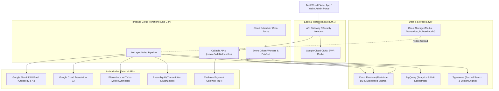
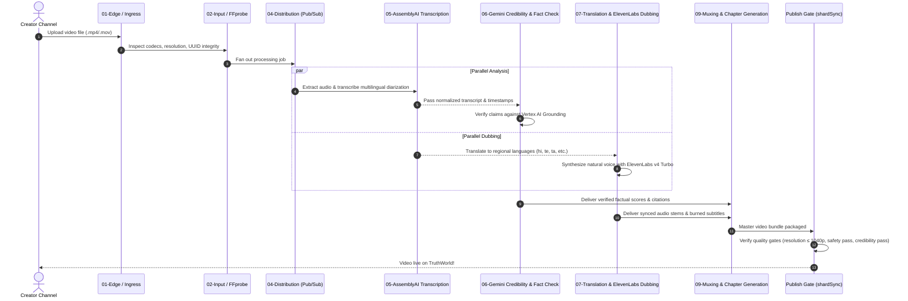
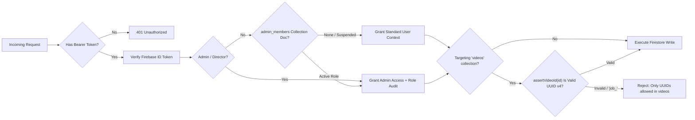

# 🏛️ TruthWorld Cloud Functions — Architecture Blueprint

> Technical architecture, data pipelines, security models, and lifecycle execution flows for TruthWorld backend services.

---

## 1. High-Level System Architecture

---

## 2. 10-Layer Video Processing Pipeline

Every video published to TruthWorld progresses through a strictly monitored multi-stage pipeline:

---

## 3. Security, Authorization & Collection Guards

---

## 4. Creator Economy & Financial Settlements

All monetization adheres strictly to the **Zero Charm-Pricing Policy** using clean round numbers:

1. **Cashfree Payments**:
   - Webhook signatures validated cryptographically using HMAC-SHA256.
   - Idempotency enforced via Firestore transaction L1/L2 lock before wallet updates.
2. **Channel Wallet**:
   - Micro-transactions tracked in immutable audit logs.
   - Automated monthly disbursal scheduler with anomaly detection.
3. **Ad Revenue Splits**:
   - View fraud detection checks for unnatural pulses or automated bot clusters.
   - Legitimate view impressions distributed proportionally to creator channels.
